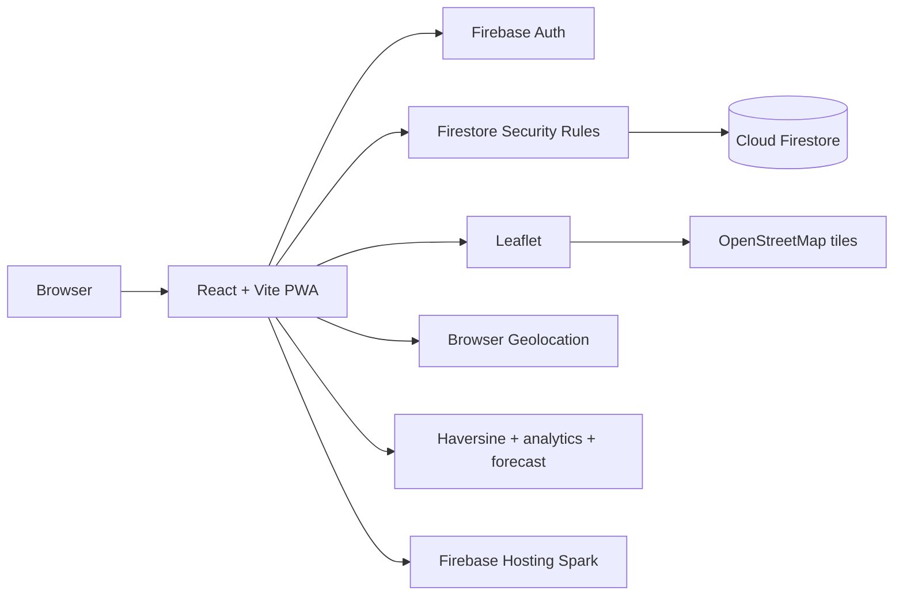

# System Architecture

## Overview

FoodBridge MVP is a client-rendered React PWA using Firebase Authentication and Cloud Firestore directly. Firestore Security Rules enforce data access. There is no custom API server or serverless function because the project must stay on Firebase Spark.

## Modules

1. Identity/profile: Auth UID, profile, membership and account status.
2. Organisation onboarding: donor/NGO/farm/facility details; admin approval recorded without storing scans.
3. Listings: create, publish, update, withdraw and time-bound availability.
4. Recipient feed: eligibility filters, approximate location and straight-line distance.
5. Claims: Firestore transaction with one-winner semantics.
6. Handover: donor and recipient confirmations and dispute status.
7. Mess analytics: prepared/served/leftover entries and bounded descriptive reports.
8. Impact: measured quantities and separately labelled estimates.
9. Admin: manually provisioned admin role; review queues and audit records.

## Deliberate constraints

No shared media upload, SMS, WhatsApp, email provider, push notification server, background scheduler, Cloud Functions, Cloud Storage, AI inference or turn-by-turn routing in MVP. The app cannot guarantee a task runs while every client is offline. Expiry is checked during reads and claim transactions.

## Trust boundaries

The browser is untrusted. Auth proves identity only. Firestore rules enforce role, ownership, allowed fields and state transitions. Do not rely on disabled buttons or client-only role checks. Admin provisioning is performed in Firebase Console and never exposed as a public client action.

## Scalability posture

This is a controlled pilot architecture. Design paginated queries, composite indexes, bounded listeners, low-frequency updates and quota-aware reads. If pilot scale exceeds Spark quotas, degrade safely and stop writes; do not upgrade. A future architecture change requires owner approval and a fresh zero-cost audit.

## Cost and implementation constraint

This document is subordinate to [`architecture/ZERO_COST_ARCHITECTURE.md`](../architecture/ZERO_COST_ARCHITECTURE.md) (adjust relative path if needed) and [`architecture/FREE_SERVICE_REGISTER.md`](../architecture/FREE_SERVICE_REGISTER.md). Firebase Spark only; no billing account, paid API, paid storage, SMS, AI API or paid hosting. Defer any feature that cannot be delivered within those constraints.
