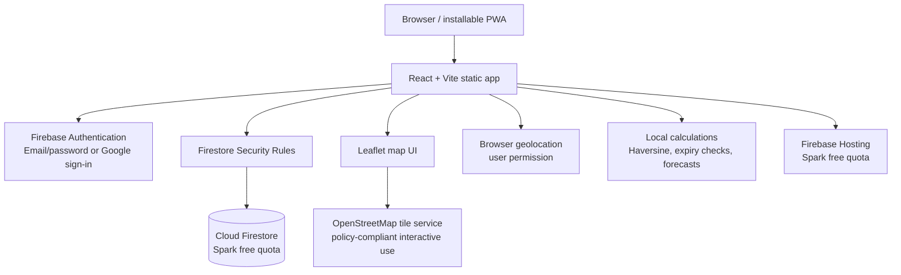

# Zero-Cost Architecture — Binding Technical Decision

## 1. Objective and boundary

Build, test and pilot FoodBridge without requiring a payment method, paid API, paid hosting, paid database, paid AI model, paid map service or paid communications provider. The Firebase project must stay on **Spark**. Do not link a Google Cloud Billing account. Do not accept an upgrade prompt as a normal implementation step.

The design is intentionally smaller than a conventional production architecture because Firebase Spark does not provide Cloud Functions and Firebase Cloud Storage access is not available on Spark under current Firebase requirements. A feature that needs a trusted server, a scheduled worker or shared file storage must be deferred or handled manually until a genuinely no-cost option is deliberately reviewed.

## 2. Architecture diagram

There is no custom backend server, Cloud Function, Cloud Run service, SQL database, Redis, object-storage bucket, AI API or paid integration in the MVP.

## 3. Approved technology choices

| Concern | Approved choice | Cost control |
|---|---|---|
| UI | React, Vite, JavaScript | Open-source packages; no paid component library |
| Auth | Firebase Auth email/password; optional Google provider | Never use phone/SMS authentication |
| Database | Cloud Firestore | Spark only; monitor daily read/write/storage/egress quotas |
| Hosting | Firebase Hosting | Spark quotas; use provider subdomain |
| Maps | Leaflet + OSM tiles | No Google Maps/Mapbox API; obey tile usage policy |
| Geolocation | Browser Geolocation API | No external location API; user permission required |
| Distance | Haversine formula in JavaScript | No routing API; straight-line estimate only |
| Prediction | JavaScript moving average and weekday aggregates | No ML API or model hosting |
| Notifications | In-app Firestore records and live listeners while app is open | No SMS, WhatsApp, email provider, Cloud Functions or FCM server sender |
| File evidence | Manual/offline review for MVP | No Firebase Storage; no public file host |
| Testing | Vitest, Testing Library, Playwright local, ESLint | Open-source; run locally |
| Source control | Git + GitHub Free | Manual build/deploy; no paid CI required |

## 4. Identity and account model

Use Firebase Authentication email/password as the default. Google sign-in is optional. Firebase's default verification/password-reset email features are used within Spark limits. Do not implement phone OTP: Firebase phone verification SMS is billed/Blaze-only. Do not use Twilio, MSG91, WhatsApp Business API or any other SMS/WhatsApp provider.

Every new account starts with a minimal `users/{uid}` profile and a pending membership/application. Users cannot assign themselves privileged roles or verified status. An administrator is provisioned manually by the project owner in the Firebase console. Admin role documents are written only through the console for the initial MVP; Firestore rules deny client writes to admin-role records. Keep an offline record of the initial admin UID and recovery procedure.

## 5. Firestore design and integrity

Use a small, documented collection model. All client writes are validated by Firestore Security Rules. Sensitive state transitions use Firestore transactions and re-check listing state, deadline, recipient approval and role in the transaction. Security rules must independently restrict fields and ownership; never trust hidden UI controls.

Firestore transactions can atomically update a listing and create its claim. Add deterministic claim IDs or transaction checks so only one active claim can win. A client-side button lock is not a concurrency control.

Firestore rules cannot perform arbitrary server-side business logic. Keep all safety-critical validation expressible as rule conditions plus transaction reads/writes. If a future requirement cannot be secured this way, do not weaken rules; defer it rather than introduce a paid server silently.

## 6. Expiry without scheduled jobs

No Cloud Scheduler or Cloud Functions. A listing is treated as expired whenever a client loads it, displays it, or attempts to claim it if `consumeBy <= request.time` / current trusted request time. The claim transaction rechecks the deadline. A client may write a status transition to expired only when rules permit and the deadline has passed. Expiry is therefore enforced at use time; a listing may remain stored with an old status until next interaction. Do not promise a background timer that runs while all users are offline.

## 7. Matching and maps

Store latitude/longitude only after explicit user action and consent. Use Firestore geohash ranges (e.g. an open-source geohash utility) to narrow candidate documents, then compute exact straight-line distance with Haversine and filter by configured radius. Display an approximate marker before a claim and reveal exact pickup details only to the accepted recipient.

Use Leaflet for map rendering and OpenStreetMap tiles only for ordinary, interactive viewport requests. Display `© OpenStreetMap contributors` attribution visibly. Follow the current OSM tile policy: correct HTTPS endpoint, browser Referer, cache headers, no bulk downloads, no offline tile packs, no prefetching, and accept best-effort availability/no SLA. Do not build a geocoder using public Nominatim as a generic search endpoint; users can place a pin manually and enter an address. If OSM tiles are unavailable, fall back to a plain address/distance list.

No turn-by-turn routing, travel-time promise, fleet optimisation, traffic, address autocomplete or Google Maps API.

## 8. Media and document verification

Firebase Cloud Storage buckets are not accessible from Spark under current Firebase guidance; enabling access requires Blaze. Therefore do not configure Firebase Storage. Do not store images or identity documents in Firestore. Firestore document size and quota make it unsuitable as a file store, and sensitive document access would be difficult to manage safely.

For the MVP, use in-person/offline document inspection by an administrator. Record only verification status, reviewer, date, checklist result and minimal reference notes. Do not collect identity-document scans in the application. Listing photo upload, proof-of-distribution photos and OCR are deferred. A local camera preview may be used for UX testing but must not be described as uploaded or shared evidence.

## 9. Notifications and automation

MVP notifications are Firestore notification documents shown in the app while a user is signed in. Real-time listeners update open sessions. There is no guarantee of a notification while the app is closed. No scheduled email, SMS, WhatsApp, push campaign or server-side broadcast. No Cloud Functions or third-party automation platform.

## 10. Analytics and prediction

Compute descriptive analytics from records already loaded within Firestore quotas. Use small paginated date ranges and aggregate records at write time only when security rules can validate the operation. For the first pilot, use straightforward client-side aggregation over a bounded data window. Forecasts use moving averages and weekday/meal grouping after enough complete observations exist. Show sample size, window and an explicit estimate label. No Gemini, OpenAI, Vertex AI, external model API or hosted ML service.

## 11. Safe-stop behavior

- If Firestore quota is exhausted, show a clear temporary-unavailable state; do not switch providers or request a paid upgrade.
- If Hosting transfer/storage reaches Spark quota, stop deployment/serving as the plan dictates and reduce assets; do not upgrade.
- If map tiles fail, show address and straight-line distance without map.
- If no background worker exists, expiry is enforced on interaction and displayed as “checked on refresh/claim”.
- If an action requires file uploads, SMS or server code, show “not available in the zero-cost MVP” and provide the documented manual process.

## 12. Deployment

Build locally with Node.js LTS and npm. Deploy static assets to Firebase Hosting from the Firebase CLI while project remains Spark. Use `firebase.json`, Firestore rules and indexes. Never run `firebase deploy --only functions`. Use Firebase emulator suite locally for Auth/Firestore/rules tests. Use no custom domain; use the default Firebase subdomain. Keep secrets out of client code; Firebase web config is project configuration, while privileged credentials must never be placed in the browser.

## 13. Change control

Any proposed dependency must pass a cost review before implementation:
1. Is the library open-source and usable without paid hosted services?
2. Does the feature work on Firebase Spark without linking billing?
3. Does the provider require a card, billing account, paid minimum, paid quota overrun or paid production tier?
4. Is there a hidden per-SMS, per-email, per-map-load, per-request or per-user fee?
5. Can the app stop safely at free limits?

If any answer reveals a mandatory charge or billing-account requirement, reject/defer the integration. Never let Gemini/Claude decide to upgrade the Firebase project.
