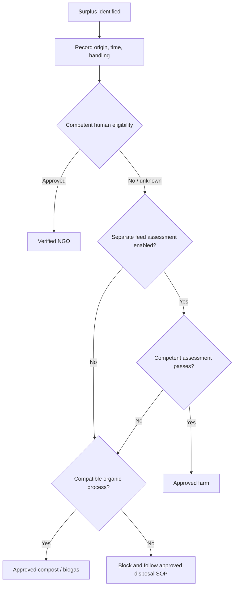

> **ZERO-COST BUILD RULE (mandatory):** FoodBridge must remain on Firebase **Spark** with no billing account linked. Do not enable Blaze, add a payment method, use paid APIs, or add any service that can generate a bill. If a feature cannot be delivered within a genuinely no-payment-required plan, defer it or provide a manual workflow. Free-tier quotas are hard limits, not permission to upgrade. Never ask the owner to upgrade to solve a quota issue. See `architecture/ZERO_COST_ARCHITECTURE.md` and `architecture/FREE_SERVICE_REGISTER.md`.

# Zero-Waste Routing

Hierarchy: **Humans First → Animals Second → Soil Third**. This is not an automatic cascade.

**Tier 1 Human:** only food explicitly eligible under approved food-safety SOP may be offered to verified NGOs.

**Tier 2 Animal:** disabled by default. Activation requires competent assessment, documented permitted material list, exclusion rules, facility-specific handling, traceable reviewer decision and veterinary/legal review. Food unsuitable for people is not automatically safe for animals.

**Tier 3 Organic:** only material compatible with a specific approved compost/biogas facility and its accepted waste stream.

States: `UNASSESSED`, `HUMAN_ROUTE_APPROVED`, `ANIMAL_ROUTE_APPROVED`, `ORGANIC_ROUTE_APPROVED`, `BLOCKED`, `EXPIRED`. Unknown means blocked from consumption pathways. Recipient may inspect and refuse at handover. AI imagery never approves a route.

Review FSSAI Food Safety and Standards (Recovery and Distribution of Surplus Food) Regulation, 2019 and applicable licensing/hygiene rules. Official index: https://www.fssai.gov.in/food-law/regulations.
